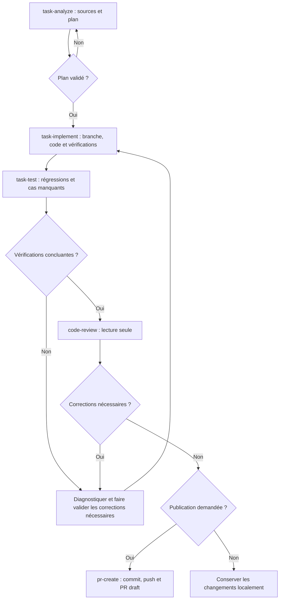

# Skills de développement

Skills GitHub Copilot CLI pour ORME Prescription : analyse Jira, implémentation,
tests, review et publication. Les conventions du dépôt cible restent prioritaires.

## Installation

Depuis la racine de `presc-workflows-tools`, avec `orme-prescription` dans le même
dossier parent :

```bash
bash skills/setup.sh
```

Le setup installe des liens personnels dans `~/.copilot/skills/`.
Voir [SETUP.md](SETUP.md) pour les prérequis, la migration, les copies locales
et la désinstallation.

Pour les cinq skills du parcours principal, le [contrat commun](WORKFLOW.md)
définit la résolution du ticket, les autorisations, l'accès Jira, le périmètre Git
et le choix des outils de vérification. Il évite de dupliquer ces règles.

## Parcours principal : cinq skills

| Commande | Responsabilité | Limite |
|---|---|---|
| `/task-analyze <TICKET>` | Lit le ticket, tous les commentaires, les pièces jointes et les sources pertinentes ; sauvegarde un plan à valider | Aucun changement de code, de branche ou de PR |
| `/task-implement` | Implémente le plan approuvé ; prépare la branche si nécessaire ; vérifie, formate et lint les changements | Pas de commit ni de push |
| `/task-test` | Lance les tests impactés, ajoute les cas utiles manquants et diagnostique les échecs | Ne modifie pas les attentes pour masquer une régression |
| `/code-review` | Relit le périmètre complet, front et back, en cherchant les défauts démontrables | Lecture seule, y compris pour les leçons |
| `/pr-create` | Commit et pousse les changements approuvés si nécessaire, puis crée une PR draft | Publication uniquement sur demande explicite |

Le workflow inclut les commits de la branche **et** les changements staged,
unstaged et nouveaux fichiers. La base et les commandes viennent du dépôt et
de ses configurations, pas d'un `main...HEAD` ou d'un runner Jest imposé.



Les étapes ne s'enchaînent pas sans respecter leurs autorisations. Un contrôle
bloqué ou aucun test exécuté n'est jamais présenté comme un succès.

## Exemples

```text
/task-analyze ORBISBUG-1234
```

Lit les sources du ticket et le code pertinent, puis écrit
`.copilot/analyses/ORBISBUG-1234-ANALYZE.md`. Présente la recommandation et
demande validation, sans créer de branche.

```text
/task-implement
```

Relit le plan et vérifie l'accord explicite. Si une branche doit être créée,
fait valider sa base et sa destination. Pour ORME, utilise la clé de la story
parente pour une feature, pas celle d'une sous-tâche. L'accord doit rester
disponible dans la conversation ou être consigné fidèlement dans le rapport :
il n'est plus recommandé de lancer systématiquement `/clear`.

```text
/task-test
/code-review
```

Les tests utilisent les runners réels des modules, notamment Vitest si la
configuration Angular le prévoit. La review couvre aussi le Java et ne modifie
ni le code ni `.copilot/lessons.md`.

```text
/pr-create
```

Publie les seuls changements approuvés vers la base réelle du dépôt.
Pour ORME avec ticket Jira, conserve les titres `feat(HORME-XXXX): ... /fixed`
ou `fix(ORBISBUG-XXXX): ... /fixed` et le label `WORKFLOWS`.
Un autre dépôt sans Jira n'est pas forcé à utiliser ces conventions.

## Migration des anciennes commandes

| Commande retirée | Remplacement |
|---|---|
| `/task-start` | `/task-analyze`, puis `/task-implement` après validation ; la branche est préparée à ce moment |
| `/test-check` | `/task-test` |
| `/test-implement` | `/task-test` |
| `/code-lint` | Formatage/lint intégrés à `/task-implement` et `/task-test`, ou commandes habituelles du projet |

Ces commandes sont retirées, pas conservées comme alias. Relancer le setup
après mise à jour : il ajoute `task-test` et retire uniquement les anciens liens
personnels qui pointent vers ce même dépôt. Les copies et liens d'autres sources
ne sont pas supprimés. Voir la [procédure de migration](SETUP.md#migration).

## Skills spécialisés conservés

| Commande | Usage |
|---|---|
| `/gsupport-analyze <GSUPPORT-XXXXX>` | Qualifie une remontée client, lit commentaires et pièces jointes et produit `<KEY>-analyse.md`, sans branche ni PR |
| `/pr-fix-build <branch> [format\|tests]` | Corrige une branche distante dans un worktree, avec commit et push selon son contrat propre |
| `/story-architecture-diagram` | Documente une architecture déjà définie avec rapport et diagrammes Mermaid, sans concevoir ni implémenter la solution |

Le contrat commun ne remplace pas les contrats de ces skills spécialisés.
`gsupport-analyze` conserve pour l'instant sa configuration Jira Server/PAT :
sa migration Cloud n'est pas incluse ici. Les cinq skills du parcours principal
documentent Cloud (e-mail et API token) et Server (PAT).

`update-lib` est un script shell, pas un skill :
voir le [catalogue des scripts](../scripts/README.md#update-lib).

## Contribuer

Chaque skill est un dossier contenant un `SKILL.md` normatif. Pour les cinq skills
du parcours principal, `WORKFLOW.md` fait aussi partie du contrat et doit être
distribué avec eux. Les fichiers `config.json` éventuels portent les connaissances
spécifiques, et `ARCHITECTURE.md` décrit les flux des skills qui en disposent.

Toute modification de flux doit mettre à jour le diagramme correspondant dans
le même commit : celui de cette page pour le parcours principal, et
`ARCHITECTURE.md` s'il existe pour le skill concerné. Valider les diagrammes
Mermaid avant de committer. Une modification visible pour l'utilisateur doit
aussi mettre à jour le catalogue et les exemples.

Pour vérifier l'installation sans toucher aux skills actifs :

```bash
bash skills/tests/setup.test.sh
```
