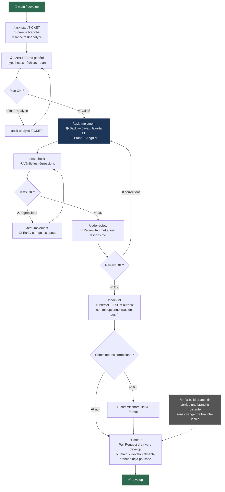

# presc-workflows-tools

Skills GitHub Copilot CLI pour le repo `orme-prescription` — automatisation du workflow de développement Angular et Java / Jakarta EE (Jira, branches, implémentation, tests, review, lint, PR).

## Prérequis

- [GitHub Copilot CLI](https://docs.github.com/en/copilot/how-tos/copilot-cli/install-copilot-cli) installé
- `gh` CLI installé et authentifié (`gh auth login`)
- Variables d'environnement Jira dans `~/.bashrc` :
  - `JIRA_DOMAIN` (ex: `jira.dedalus.com`)
  - `JIRA_API_TOKEN` (Personal Access Token Jira)

**Jira Cloud :** les contrats des skills Jira de ce dépôt décrivent encore
l'ancienne configuration Jira Server (`jira.dedalus.com`, PAT). Ils ne
documentent pas encore l'authentification Cloud par e-mail et API token ;
changer uniquement `JIRA_DOMAIN` ne suffit pas à adapter les commandes.

## Installation

Avoir les deux repos dans le même dossier parent, puis depuis la racine de ce repo :

```bash
bash skills/setup.sh
```

Voir [SETUP.md](SETUP.md) pour les détails et la désinstallation.

## Catalogue des skills

| Skill              | Commande | Quand | Avantage                                                                   | Description                                                                                                                                   |
|--------------------|---|---|----------------------------------------------------------------------------|-----------------------------------------------------------------------------------------------------------------------------------------------|
| **task-start**     | `/task-start <TICKET>` | `main` / `develop` | Branche + analyse en une seule commande                                    | Crée la branche depuis un ticket Jira et lance l'analyse                                                                                      |
| **task-analyze**   | `/task-analyze <TICKET>` | n'importe quelle branche | Plan structuré avant de coder, évite les mauvaises pistes                  | Analyse un ticket Jira, investigue le code, génère un `ANALYZE.md`                                                                            |
| **gsupport-analyze** | `/gsupport-analyze <GSUPPORT-XXXXX>` | n'importe quelle branche | Qualifie un ticket client avant d'ouvrir un ORBISBUG inutile | Analyse un ticket client GSUPPORT : lit **tous** les commentaires et **toutes** les pièces jointes, investigue le code, qualifie la nature du problème et génère un `<KEY>-analyse.md` |
| **task-implement** | `/task-implement` | branche de la tâche | Faire `/clear` avant — le contexte est dans `ANALYZE.md`                   | Implémente le code (🟠 Java/Jakarta EE back et/ou 🔵 Angular front) en s'appuyant sur les règles du projet et les leçons passées              |
| **test-check**     | `/test-check` | branche de la tâche | Détecte les régressions avant la PR, évite les surprises en CI             | Vérifie que les changements n'ont pas cassé de tests existants (🔵 Angular + 🟠 Java) — appelle `/test-implement` si des tests échouent       |
| **test-implement** | `/test-implement` | branche de la tâche | Génère le boilerplate des tests manquants automatiquement                  | Écrit et corrige les tests (🔵 specs Angular + 🟠 tests JUnit) pour les fichiers sans couverture et les tests en échec                        |
| **code-review**    | `/code-review` | branche de la tâche | Catch les erreurs avant la review humaine, enrichit `lessons.md`           | Review IA du diff Angular (règles front et leçons passées)                                                                                      |
| **code-lint**      | `/code-lint` | branche de la tâche | Format + lint auto-fix, commit optionnel — jamais de push automatique      | Prettier + ESLint auto-fix sur les fichiers modifiés, puis propose un commit des corrections                                                  |
| **pr-create**      | `/pr-create` | branche de la tâche déjà poussée | Titre formaté `feat/fix(TICKET)`, label WORKFLOWS, body généré depuis Jira | Crée la Pull Request GitHub (draft) vers `develop` (ou `main` si absente), avec le bon format de titre et le label WORKFLOWS |
| **pr-fix-build**   | `/pr-fix-build <branch> <fix>` | n'importe quelle branche | Corrige la branche d'une PR sans `git stash` ni `checkout`                 | Corrige le build d'une branche distante (format, lint, tests) sans changer de branche locale                                                  |
| **story-architecture-diagram** | `/story-architecture-diagram` | architecture déjà définie | Formalise les décisions et les flows sans écrire de code | Produit un rapport d'architecture et des diagrammes Mermaid depuis un fichier, le contexte courant ou un échange guidé |

## Contribuer à un skill

Chaque skill est un dossier sous `skills/` contenant au minimum un `SKILL.md` (le contrat, seul
fichier normatif), parfois un `config.json` (la connaissance : repos, domaines, glossaire, modèles)
et, pour les skills les plus gros, un `ARCHITECTURE.md` (la vue d'ensemble en schémas Mermaid).

**Règle : toute modification du flux d'un skill doit mettre à jour son `ARCHITECTURE.md` dans le
même commit.** Cela s'applique aussi aux modifications faites par un agent : s'il édite le
`SKILL.md`, il répercute les schémas avant de rendre la main, sans qu'on ait à le lui demander.

Le déclencheur, c'est le **flux** — qui exécute quoi, dans quel ordre, avec quelles entrées et
quelles sorties. Une simple précision de rédaction dans une étape existante ne demande pas de
toucher aux schémas. Chaque skill documenté précise la correspondance changement → schéma dans sa
section « Maintenir la documentation d'architecture » (voir
[gsupport-analyze](gsupport-analyze/SKILL.md)).

Deux réflexes qui vont avec :

- **valider les diagrammes Mermaid avant de committer** — un diagramme invalide ne s'affiche
  simplement pas sur GitHub, donc personne ne le remarque ;
- si le changement modifie ce que le skill fait **pour l'utilisateur** (et pas seulement comment il
  le fait), mettre aussi à jour sa ligne dans le catalogue ci-dessus et son exemple d'utilisation.

## Exemples d'utilisation

### `/task-start`
```
/task-start ORBISBUG-1234
```
> Crée la branche `main/presc/bugfix/ORBISBUG-1234` depuis la branche courante, puis lance automatiquement `/task-analyze ORBISBUG-1234`. Pour une story `HORME-1234`, le nom est `main/presc/feature/HORME-1234`. Se placer sur la branche de base souhaitée avant de lancer la commande.

---

### `/task-analyze`
```
/task-analyze ORBISBUG-1234
```
> Lit le ticket Jira, explore les fichiers impactés, propose des hypothèses d'implémentation et génère `.copilot/analyses/ORBISBUG-1234-ANALYZE.md` avec le plan de travail.

---

### `/gsupport-analyze`
```
/gsupport-analyze GSUPPORT-47944
/gsupport-analyze https://jira.dedalus.com/browse/GSUPPORT-47944
```
> Analyse une remontée **client**. Lit le ticket, **tous** les commentaires et **toutes** les pièces jointes (captures, scénarios `.docx` et leurs images embarquées), investigue le code **sur plusieurs repos** (`config.json`) en suivant la chaîne message d'erreur → front → REST → service → données, puis **qualifie** la demande : bug dans notre code, problème de configuration/données, comportement attendu, évolution, ou informations insuffisantes. Génère `.copilot/analyses/<KEY>-analyse.md` avec les hypothèses, les informations manquantes (et qui peut les fournir), les questions à poser au client et un brouillon de réponse support.
>
> Les repos fouillés sont déclarés dans `skills/gsupport-analyze/config.json` — à adapter à son poste.
>
> C'est l'étape **amont** de `/task-analyze` : elle décide si un `ORBISBUG` ou un `HORME` doit être créé.

---

### `/task-implement`
```
/task-implement
```
> ⚠️ **Lancer `/clear` avant** pour démarrer avec un contexte propre — le contexte nécessaire est déjà dans `ANALYZE.md`.
>
> S'appuie sur le `ANALYZE.md` généré, les `front-rules`, `java-coding-style` et `lessons.md` pour implémenter les changements.

---

### `/test-check`
```
/test-check
```
> Détecte les specs impactées par les fichiers modifiés et les lance. Si des tests échouent, appelle automatiquement `/test-implement` pour les corriger.

---

### `/test-implement`
```
/test-implement
```
> Génère les specs manquantes pour les fichiers sans couverture, et corrige les specs en échec. Peut être appelé manuellement ou automatiquement par `/test-check`.

---

### `/code-review`
```
/code-review
```
> Analyse le diff Angular `main...HEAD` (`src/**/*.ts`, `src/**/*.html`, `src/**/*.scss`), signale les violations des règles front et des leçons passées. Met à jour `lessons.md` si une nouvelle erreur bloquante est identifiée.
>
> **`lessons.md`** — fichier local qui accumule les erreurs récurrentes détectées lors des reviews précédentes. Il sert de mémoire long terme : chaque `/code-review` le consulte pour éviter de répéter les mêmes erreurs, et l'enrichit si une nouvelle erreur bloquante est identifiée.

---

### `/code-lint`
```
/code-lint
```
> Lance Prettier + ESLint auto-fix sur les fichiers modifiés. Si tout est propre, **demande si vous souhaitez committer** les corrections.

---

### `/pr-create`
```
/pr-create
```
> Depuis une branche déjà poussée, génère le titre au format `feat(HORME-XXXX): ... /fixed` ou `fix(ORBISBUG-XXXX): ... /fixed` depuis le ticket Jira, génère le body depuis les changements effectués, applique le label **WORKFLOWS** et crée la PR en draft vers `develop` (ou `main` si `develop` n'existe pas).

---

### `/pr-fix-build`
```
/pr-fix-build main/presc/bugfix/ORBISBUG-5678
/pr-fix-build main/presc/bugfix/ORBISBUG-5678 format
/pr-fix-build main/presc/bugfix/ORBISBUG-5678 tests
```
> Ouvre la branche d'une PR dans un worktree temporaire, applique le fix demandé (`format` ou `tests`), commit et push — sans toucher à ta branche locale. Si le type de fix est omis, le skill demande lequel appliquer.

---

### `/story-architecture-diagram`
```
/story-architecture-diagram
```
> Documente une architecture déjà décidée et produit un rapport avec des diagrammes Mermaid, sans concevoir la solution ni générer de code. Fournir un fichier, utiliser le contexte de conversation ou préciser l'architecture par questions/réponses.

`update-lib` est un script shell, pas un skill : voir le [catalogue des scripts](../scripts/README.md#update-lib).

## Workflow


> **Légende** : les nœuds en pointillés (grisés) sont des outils utilitaires utilisables à tout moment, hors du flux principal.
